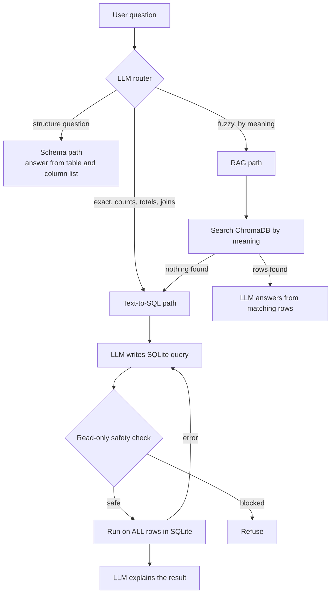

# 💬 Chat with Your Data

Ask questions about any CSV file in plain English, and get exact answers.

**🔗 Live app:** https://chat-with-your-data-sameer.streamlit.app/

Upload one or more CSV files (or try the built-in Walmart retail sample), then ask things like:

- *"What is the total revenue per store?"*
- *"How many orders were cancelled?"*
- *"What products did customer Ronald Long order?"*
- *"Suggest some products for someone who loves sports"*
- *"What columns does the customers table have?"*

Every answer shows **how** it was produced: the route used, the exact SQL query, and the full result table, which you can sort and download.

---

## How it works

The app combines two techniques and lets an LLM router decide which one each question needs.



**1. RAG (Retrieval-Augmented Generation)**
Each row is converted to text (`column: value | column: value`), turned into a 384-number embedding with `all-MiniLM-L6-v2`, and stored in ChromaDB. For fuzzy questions, the closest rows are retrieved and passed to the LLM. Great for *"find me something like X"*.

**2. Text-to-SQL**
All tables are loaded into an in-memory SQLite database. The LLM receives the schema (including the allowed values of category-like columns) and writes a query, which runs on **every row**. The LLM then explains the result in plain English. Great for counts, totals, rankings, joins, and "list all".

**3. Router**
The LLM classifies each question as `sql`, `rag` or `schema`, and for RAG also picks the table to search. Its JSON output is validated in Python, and SQL is the safe fallback.

---

## Why both RAG and SQL? (What testing showed)

I first built pure RAG, then checked every answer against ground truth computed with pandas:

| Question | Pure RAG | Truth |
|---|---|---|
| How many orders were cancelled? | 10 | **2,587** |
| Most expensive product? | $370.89 | **$498.66** |
| List all Samsung Home products | 7 found | **16** |
| Tell me about customer Ronald Long | "I don't know" | Customer #1 |

RAG only shows the LLM a handful of matching rows, never the whole table, so it cannot count, sum, rank or join. After adding Text-to-SQL and the router, accuracy on the same test set went from **2/5 to 7/7**.

Other lessons:

- **LLMs read, they don't calculate.** Given 25 unsorted store totals, the LLM mis-ranked them. Fix: SQL does the `ORDER BY`, the LLM only describes the top rows.
- **Hidden assumptions change answers.** The LLM silently added `is_active = 'Y'` filters. A prompt rule now forbids filters the user didn't ask for.
- **Embeddings are weak with exact names and IDs** among many similar rows, which is another reason exact lookups go to SQL.

---

## Safety and privacy

- **Read-only SQL:** every generated query must start with `SELECT`/`WITH` and is scanned word-by-word for `INSERT`, `UPDATE`, `DELETE`, `DROP`, `ALTER`, `CREATE`, `ATTACH`, `PRAGMA`. Whole-word matching means a column like `updated_timestamp` is not falsely blocked.
- **LLM output is always validated:** router JSON, table names and SQL are checked in Python before use.
- **Self-correction:** if a query fails, the error is sent back to the LLM for one corrected attempt.
- **Private sessions:** each visitor's data and chat live only in their own Streamlit session. Uploaded files are never saved to disk.
- **Isolated vector data:** each upload gets its own uniquely named ChromaDB collection. Old collections are deleted when new data is loaded, and any collection idle for 1 hour is cleaned up.
- **Interruption-safe state:** slow work happens first, and session state is committed at the end, so an interrupted run never leaves half-loaded data.
- **Abuse limits:** 25 MB per file and 30 questions per session protect the free server and API quota.
- **Secrets:** the Groq API key is read from `.env` locally and from Streamlit Secrets in production. It is never committed.
- **Honest answers:** the LLM answers only from provided data and says so when nothing matches.

---

## Tech stack

| Purpose | Tool |
|---|---|
| Language | Python |
| Data handling | pandas |
| Embeddings | sentence-transformers (`all-MiniLM-L6-v2`), CPU-only PyTorch |
| Vector database | ChromaDB |
| LLM orchestration | LangChain (`langchain-core`, `langchain-chroma`, `langchain-groq`, `langchain-huggingface`) |
| LLM | `openai/gpt-oss-120b` via Groq |
| SQL engine | SQLite (in-memory) |
| UI and hosting | Streamlit, Streamlit Community Cloud |

---

## Project structure

```
chat-with-your-data/
├── app.py               # Streamlit UI: uploads, chat, sessions, limits, cleanup
├── engine.py            # The "brain": build_engine, RAG, Text-to-SQL, router, chat
├── chatbot.ipynb        # Step-by-step notebook where everything was built and tested
├── data/                # Sample Walmart retail dataset (6 tables)
├── requirements.txt     # Pinned dependencies (CPU-only PyTorch)
└── .streamlit/
    └── config.toml      # Upload size limit
```

---

## Run it locally

```bash
git clone https://github.com/up-code137/chat-with-your-data.git
cd chat-with-your-data

python -m venv venv
# Windows
venv\Scripts\activate
# Mac/Linux
source venv/bin/activate

pip install -r requirements.txt
```

Create a `.env` file in the project folder with your free Groq API key (from https://console.groq.com):

```
GROQ_API_KEY=your_key_here
```

Then run:

```bash
streamlit run app.py
```

---

## Known limitations

- Tables larger than 2,000 rows are SQL-only (not embedded), to keep upload time short. Fuzzy questions on them are answered via SQL `LIKE` matching.
- Fuzzy questions may give slightly different answers between runs, since the LLM can choose different keywords.
- The chatbot doesn't yet remember earlier questions in a conversation (follow-ups like *"what about Sony?"*).
- Refreshing the page clears the session, by design, since no user data is stored.
- The per-session question limit is a soft limit (a new session resets it).

## Future improvements

- **Login and saved history** with Firebase Authentication and Firestore, so users can return to their data and chats.
- **Conversation memory** for follow-up questions.
- **Hybrid search** (keywords + embeddings) for better matching on names and IDs.
- **Stronger rate limiting** per user or IP.

---

## Author

**Sameer Sinha**, final year B.Tech (IT)
Built as my first AI project, coming from a data engineering background (Airflow, dbt, Databricks, Docker, AWS).

GitHub: [@up-code137](https://github.com/up-code137)
